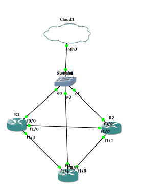

# Partie 3 — Réseau & Collecte (Marwa)

## Topologie GNS3 (SCRUM-15)

- 3 routeurs Cisco c7200 (R1, R2, R3) reliés en triangle, routage OSPF zone 0
- Réseau de gestion séparé (192.168.10.0/24) relié à la VM du collecteur via VMnet2 (VMware, host-only, sans DHCP)

| Lien | Réseau | Adresses |
|---|---|---|
| Gestion (f0/0) | 192.168.10.0/24 | R1 .1 · R2 .2 · R3 .3 · collecteur .100 |
| R1 f1/0 – R2 f1/0 | 10.0.12.0/30 | R1 .1 · R2 .2 |
| R2 f1/1 – R3 f1/0 | 10.0.23.0/30 | R2 .1 · R3 .2 |
| R3 f1/1 – R1 f1/1 | 10.0.13.0/30 | R1 .1 · R3 .2 |
| Loopback0 | — | 1.1.1.1 · 2.2.2.2 · 3.3.3.3 |

Les configurations des routeurs sont dans `gns3/R1.cfg`, `gns3/R2.cfg`, `gns3/R3.cfg`.

## Collecte SNMP et syslog (SCRUM-16)

Configuration identique sur R1, R2 et R3 :

| Élément | Valeur |
|---|---|
| SNMP | v2c, community en lecture seule, accès limité au collecteur par l'ACL 10 |
| Collecteur | 192.168.10.100 (VM Ubuntu, interface ens37 sur VMnet2) |
| Syslog | envoyé en UDP 514 vers le collecteur, niveaux 0 à 6 (`logging trap informational`) |
| Source des logs | FastEthernet0/0 (adresse de gestion du routeur) |

### OID utilisés

| Mesure | OID |
|---|---|
| Nom des interfaces (ifDescr) | 1.3.6.1.2.1.2.2.1.2 |
| CPU sur 1 minute (Cisco) | 1.3.6.1.4.1.9.9.109.1.1.1.1.7 |

### Index des interfaces (ifIndex, fixé par `snmp-server ifindex persist`)

| ifIndex | Interface |
|---|---|
| 1 | FastEthernet0/0 (gestion) |
| 2 | FastEthernet1/0 |
| 3 | FastEthernet1/1 |
| 5 | Loopback0 |

### Tests
- `snmpwalk -v2c -c <community> 192.168.10.X 1.3.6.1.2.1.2.2.1.2` liste les interfaces des 3 routeurs
- `sudo tcpdump -i ens37 -n -A udp port 514` montre la réception des messages syslog
